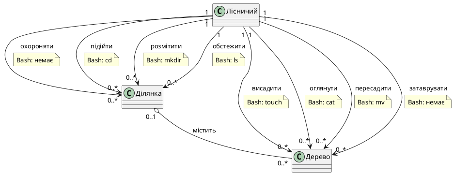

# Контрольне завдання №1

**Дисципліна:** Операційні системи  
**Студент:** Барсуков Юрій Михайлович, група АС-244  
**Варіант:** 2  
**Предметна область:** Екологія та лісництво

## Початковий опис предметної області

Лісничий має охороняти ділянку, підійти до ділянки, розмітити ділянку та обстежити ділянку. Для роботи з деревом слід висадити дерево, оглянути дерево, пересадити дерево та затаврувати дерево.

## 1 Визначення сутностей

| UML-роль | Сутність | Обґрунтування |
|---|---|---|
| Actor | Лісничий | Виконує всі дії над ділянками та деревами. |
| Aggregate | Ділянка | Є контейнером для дерев і відповідає каталогу файлової системи. |
| Part | Дерево | Є окремим елементом ділянки й відповідає файлу. |

Між ділянкою та деревом обрано **агрегацію**. Дерево можна пересадити на іншу ділянку, тому воно здатне існувати окремо від початкового контейнера. Операція рекурсивного видалення `rm -r` розглядається як граничний випадок знищення ділянки разом із деревами, які не були попередньо пересаджені.

Кратність зв'язків:

- один лісничий працює з `0..*` ділянками;
- один лісничий працює з `0..*` деревами;
- одна ділянка містить `0..*` дерев;
- дерево одночасно належить `0..1` ділянці, оскільки під час пересаджування може тимчасово не належати жодній.

## 2 Семантичні відповідності

Спочатку наведено 12 базових Bash-команд у визначеному завданням порядку.

| Операція ПрО | Операція Bash-команди | Bash-команда | Обґрунтування вибору |
|---|---|---|---|
| підійти до ділянки | перейти у каталог | `cd` | Перехід до потрібної ділянки відповідає переходу до каталогу. |
| розмітити ділянку | створити каталог | `mkdir` | Розмітка створює нову ділянку-контейнер. |
| висадити дерево | створити файл | `touch` | Висаджування означає появу нового елемента. |
| — | змінити файл | `nano` | У вибраній моделі немає дії редагування інформаційного вмісту дерева. |
| обстежити ділянку | переглянути каталог | `ls` | Обстеження ділянки відповідає перегляду її вмісту. |
| оглянути дерево | переглянути файл | `cat` | Огляд окремого дерева відповідає перегляду вмісту одного файла. |
| пересадити дерево | перемістити файл | `mv` | Дерево переноситься до іншої ділянки так само, як файл до іншого каталогу. |
| — | створити копію каталогу | `cp -r` | Опис не містить дії копіювання всієї ділянки. |
| — | створити копію файлу | `cp` | Опис не містить дії створення копії дерева. |
| — | видалити порожній каталог | `rmdir` | Опис не містить дії видалення порожньої ділянки. |
| — | видалити каталог разом із вмістом | `rm -r` | Опис не містить дії знищення ділянки з усіма деревами. |
| — | видалити файл | `rm` | Опис не містить дії видалення окремого дерева. |

Дві дії предметної області не мають коректного відповідника серед базових команд:

| Операція ПрО | Операція Bash-команди | Bash-команда | Обґрунтування вибору |
|---|---|---|---|
| охороняти ділянку | — | — | Охорона є тривалим організаційним процесом, а не одноразовою файловою операцією над каталогом. |
| затаврувати дерево | — | — | Таврування змінює фізичну ідентифікаційну ознаку дерева, а не створює, читає, копіює, переміщує або видаляє файл. |

Дії не дублюються: кожній знайденій відповідності призначено одну найближчу за змістом Bash-команду.

## 3 UML-діаграма

Вихідний код діаграми збережено у файлі [`Lisnytstvo.puml`](Lisnytstvo.puml). Діаграма містить Actor, Aggregate, Part, кратності, агрегацію та примітку `note on link` для кожної предметної дії.



## 4 Псевдоніми Bash

Псевдоніми збережено у файлі [`Lisnytstvo_aliases.sh`](Lisnytstvo_aliases.sh).

| Дія предметної області | Bash-команда | Псевдонім |
|---|---|---|
| підійти | `cd` | `pidiyty` |
| розмітити | `mkdir` | `rozmityty` |
| висадити | `touch` | `vysadyty` |
| обстежити | `ls` | `obstezhyty` |
| оглянути | `cat` | `ohlyanuty` |
| пересадити | `mv` | `peresadyty` |

Псевдоніми для дій `охороняти` та `затаврувати` не створюються, оскільки на UML-діаграмі вони позначені як `Bash: немає`.

## 5 Перевірка псевдонімів

```bash
source Lisnytstvo_aliases.sh
rozmityty test-dilyanka
vysadyty test-dilyanka/derevo.txt
echo "дуб" > test-dilyanka/derevo.txt
obstezhyty test-dilyanka
ohlyanuty test-dilyanka/derevo.txt
rozmityty druga-dilyanka
peresadyty test-dilyanka/derevo.txt druga-dilyanka/
pidiyty druga-dilyanka
```

Результат перевірки: каталог ділянки й файл дерева створюються, вміст каталогу та файла відображається, дерево переміщується до іншої ділянки, а перехід до каталогу виконується успішно.
