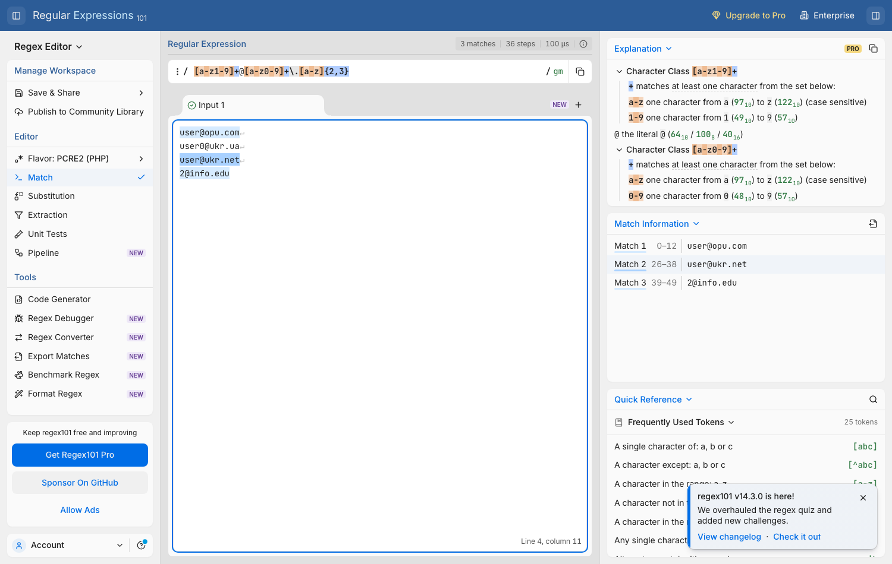

# Контрольне завдання №2

**Дисципліна:** Операційні системи  
**Студент:** Барсуков Юрій Михайлович, група АС-244  
**Варіант:** 2

## 1 Аналіз регулярного виразу

Для варіанта 2 задано шаблон:

```regex
[a-z1-9]+@[a-z0-9]+\.[a-z]{2,3}
```

Розбір шаблону:

- `[a-z1-9]+` — одна або більше малих латинських літер чи цифр від 1 до 9; цифра `0` у локальній частині заборонена;
- `@` — обов'язковий роздільник;
- `[a-z0-9]+` — доменне ім'я з малих літер і цифр від 0 до 9;
- `\.` — символ крапки;
- `[a-z]{2,3}` — доменна зона з двох або трьох малих латинських літер.

| Рядок | Відповідає шаблону | Пояснення |
|---|---|---|
| `user@opu.com` | так | Усі символи належать дозволеним діапазонам. |
| `user0@ukr.ua` | **ні** | Локальна частина `user0` містить цифру `0`, якої немає у класі `[a-z1-9]`. |
| `user@ukr.net` | так | Локальна частина, домен і зона відповідають шаблону. |
| `2@info.edu` | так | Цифра `2` дозволена класом `[a-z1-9]`. |

Отже, рядок, який **не відповідає** регулярному виразу: **`user0@ukr.ua`**.

Перевірку виконано за допомогою онлайн-інструмента regex101. На знімку три коректні рядки позначені як збіги, а `user0@ukr.ua` не виділено.



## 2 Розрахунок load average

Команда `top` показала значення:

```text
load average: 0.30, 1.51, 2.5
```

Перше число `0.30` характеризує середню завантаженість за останню хвилину. Для наступних чотирьох хвилин задано одноядерний сервер і таку присутність процесів:

| Хвилина | Присутні процеси | Процесів | Працює на CPU | Очікує у стані готовності | Довжина черги L |
|---:|---|---:|---:|---:|---:|
| 1 | P1, P2 | 2 | 1 | 1 | 1 |
| 2 | P1, P2 | 2 | 1 | 1 | 1 |
| 3 | P1, P2 | 2 | 1 | 1 | 1 |
| 4 | P4, P5 | 2 | 1 | 1 | 1 |

Для другої хвилини використано стан між першою та третьою хвилинами, як вимагає умова. На одноядерному сервері одночасно виконується один процес, тому за наявності двох процесів довжина черги готовності дорівнює `2 - 1 = 1`.

Середня довжина черги за чотири хвилини:

```text
load average(4 хвилини) = (L1 + L2 + L3 + L4) / 4
                         = (1 + 1 + 1 + 1) / 4
                         = 4 / 4
                         = 1.00
```

Відповідно до методики з додатка 3, значення за п'ять хвилин визначається як середнє між початковим однохвилинним значенням і середнім за наступні чотири хвилини:

```text
load average(5 хвилин) = (load average(1 хвилина) + load average(4 хвилини)) / 2
                        = (0.30 + 1.00) / 2
                        = 1.30 / 2
                        = 0.65
```

**Відповідь:** значення `load average` за останні п'ять хвилин становить **0.65**.
