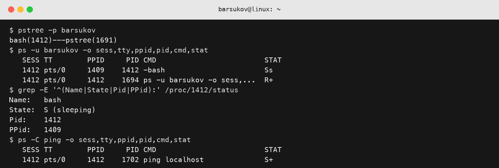
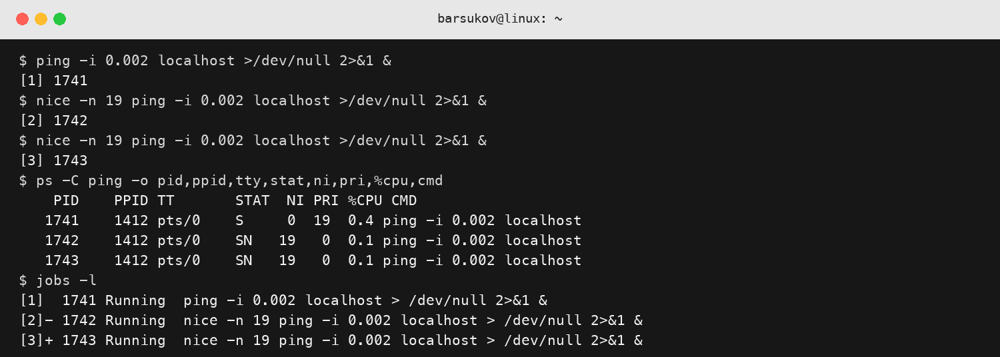
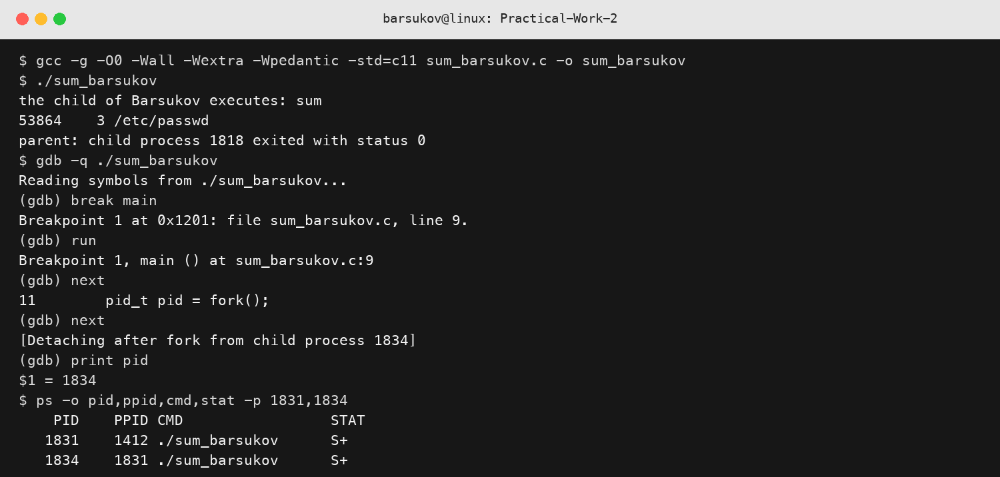

## Основи керування процесами в Unix подібних ОС

Виконав студент групи АС-244 Барсуков Юрій Михайлович. Варіант 2.

### Перегляд таблиці процесів Unix подібної ОС

Користувача створено з домашнім каталогом, Bash-оболонкою та початковими файлами з `/etc/skel`:

```bash
sudo useradd -m -d /home/barsukov -s /bin/bash -k /etc/skel barsukov
sudo passwd barsukov
su - barsukov
```

Для перегляду дерева і таблиці процесів використано команди:

```bash
pstree -p barsukov
ps -u barsukov -o sess,tty,ppid,pid,cmd,stat
BASH_PID=$(pgrep -n -u barsukov bash)
grep -E '^(Name|State|Pid|PPid):' "/proc/$BASH_PID/status"
top -o %MEM
```

У процесу `bash` значення `SESS` збігається з його `PID`, оскільки Bash є лідером поточної сесії. Стан `Ss` означає, що процес очікує події та одночасно є лідером сесії. Значення `Name`, `State`, `Pid` і `PPid` у `/proc/PID/status` відповідають даним команди `ps`.

Після запуску `ping localhost` в іншому псевдотерміналі процес має стан `S+`: переривний сон під час очікування мережевої відповіді та належність до foreground-групи термінала.



Рис. 1 - Фрагмент екрана з рішенням завдань 2.2.3-2.2.9.

### Керування пріоритетами виконання процесів

Три процеси запущено у фоновому режимі з різними значеннями `nice`:

```bash
ping -i 0.002 localhost >/dev/null 2>&1 &
nice -n 19 ping -i 0.002 localhost >/dev/null 2>&1 &
nice -n 19 ping -i 0.002 localhost >/dev/null 2>&1 &
ps -C ping -o pid,ppid,tty,stat,ni,pri,%cpu,cmd
jobs -l
```

Процес із `NI=0` має вищий динамічний пріоритет, ніж процеси з `NI=19`. За одночасного навантаження планувальник надає йому більше процесорного часу. Для `ping` різниця у `%CPU` може бути невеликою, тому що процеси переважно очікують завершення операцій введення-виведення.



Рис. 2 - Фрагмент екрана з рішенням завдань 2.3.2-2.3.4.

### Створення child процесу

Для варіанта 2 програма `sum_barsukov.c` створює дочірній процес за допомогою `fork()`. У дочірньому процесі програмний образ замінюється командою `sum -r /etc/passwd` через `execv()`. Батьківський процес очікує завершення дочірнього за допомогою `waitpid()`.

```bash
gcc -Wall -Wextra -Wpedantic -std=c11 sum_barsukov.c -o sum_barsukov
./sum_barsukov
```

### Відлагодження програми у GDB

```bash
gcc -g -O0 -Wall -Wextra -Wpedantic -std=c11 sum_barsukov.c -o sum_barsukov
gdb ./sum_barsukov
(gdb) list
(gdb) break main
(gdb) run
(gdb) next
(gdb) print pid
(gdb) continue
(gdb) quit
```

Після `fork()` у таблиці процесів видно два процеси `sum_barsukov`: батьківський і дочірній. У дочірнього процесу значення `PPID` дорівнює `PID` батьківського. Після `execv()` PID дочірнього процесу не змінюється, але його програмний образ стає `/usr/bin/sum`.



Рис. 3 - Фрагмент екрана з компіляцією, виконанням і відлагодженням програми.

### Висновок

У роботі перевірено ієрархію та стани процесів, переглянуто дані через `ps`, `pstree`, `top` і файлову систему `/proc`, досліджено вплив `nice`, а також створено дочірній процес із заміною програмного образу функцією `execv()`.
