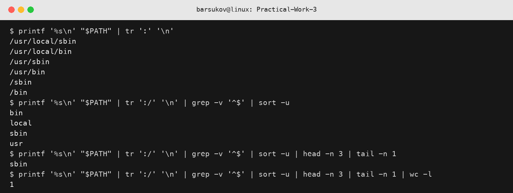
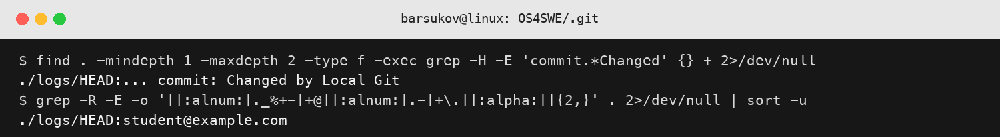
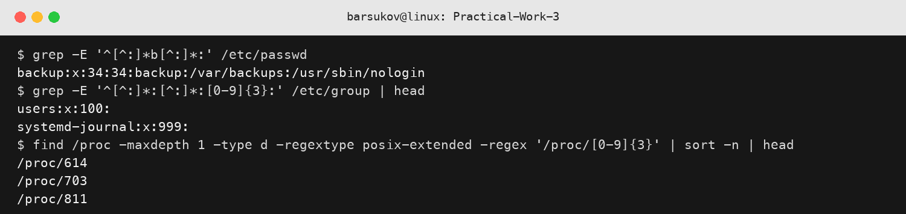
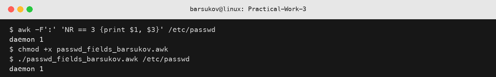

## Обробка текстових даних засобами командної оболонки Unix подібних ОС

Виконав студент групи АС-244 Барсуков Юрій Михайлович. Варіант 2.

### Проста обробка результатів виконання команд

Команди поступово утворюють конвеєр відповідно до пунктів 2.2.1-2.2.6:

```bash
# 2.2.1: кожний каталог PATH в окремому рядку
printf '%s\n' "$PATH" | tr ':' '\n'

# 2.2.2: кожний компонент шляху в окремому рядку
printf '%s\n' "$PATH" | tr ':/' '\n'

# 2.2.3: без порожніх рядків
printf '%s\n' "$PATH" | tr ':/' '\n' | grep -v '^$'

# 2.2.4: сортування та видалення дублікатів
printf '%s\n' "$PATH" | tr ':/' '\n' | grep -v '^$' | sort -u

# 2.2.5, варіант 2: третій рядок зверху
printf '%s\n' "$PATH" | tr ':/' '\n' | grep -v '^$' | sort -u | head -n 3 | tail -n 1

# 2.2.6: кількість отриманих рядків
printf '%s\n' "$PATH" | tr ':/' '\n' | grep -v '^$' | sort -u | head -n 3 | tail -n 1 | wc -l
```

Остання команда повертає `1`, тому що після вибору в потоці залишається один, третій зверху, рядок.



Рис. 1 - Фрагмент екрана з рішенням завдань 2.2.1-2.2.6.

### Складний пошук у системних файлах Git репозиторію

Пошук виконується з каталогу `.git`. Перша команда перевіряє файли не глибше двох рівнів, знаходить рядок журналу, де після слова `commit` міститься коментар `Changed`, і спрямовує помилки до `/dev/null`. Друга команда знаходить адреси електронної пошти за узагальненим регулярним виразом.

```bash
cd .git
find . -mindepth 1 -maxdepth 2 -type f -exec \
    grep -H -E 'commit.*Changed' {} + 2>/dev/null

grep -R -E -o '[[:alnum:]._%+-]+@[[:alnum:].-]+\.[[:alpha:]]{2,}' \
    . 2>/dev/null | sort -u
cd ..
```



Рис. 2 - Фрагмент екрана з рішенням завдань 2.3.1-2.3.2.

### Складний пошук за регулярними виразами у системних файлах ОС

Перша літера прізвища `Barsukov` - `b`. Для варіанта 2 кількість цифр обчислено як `N = 2 mod 4 + 1 = 3`.

```bash
# Облікові записи, назва яких містить b
grep -E '^[^:]*b[^:]*:' /etc/passwd

# Групи з тризначним GID
grep -E '^[^:]*:[^:]*:[0-9]{3}:' /etc/group

# Каталоги процесів із тризначним PID
find /proc -maxdepth 1 -type d -regextype posix-extended \
    -regex '/proc/[0-9]{3}' | sort -n
```



Рис. 3 - Фрагмент екрана з рішенням завдань 2.4.1-2.4.3.

### Складна обробка текстового файлу утилітою AWK

За варіантом 2 джерелом є `/etc/passwd`, обробляється рядок `N = 3`, виводяться перший і третій стовпчики. Роздільник полів - двокрапка.

```bash
awk -F':' 'NR == 3 {print $1, $3}' /etc/passwd
chmod +x passwd_fields_barsukov.awk
./passwd_fields_barsukov.awk /etc/passwd
```

Обидва способи дають однаковий результат. AWK-скрипт збережено у файлі `passwd_fields_barsukov.awk`.



Рис. 4 - Фрагмент екрана з рішенням завдань 2.5.1-2.5.3.

### Висновок

У роботі побудовано конвеєри команд для обробки `PATH`, застосовано рекурсивний пошук і розширені регулярні вирази до файлів Git та системних файлів Linux, а також реалізовано вибір рядка й стовпчиків засобами AWK у командному рядку та окремому виконуваному скрипті.
